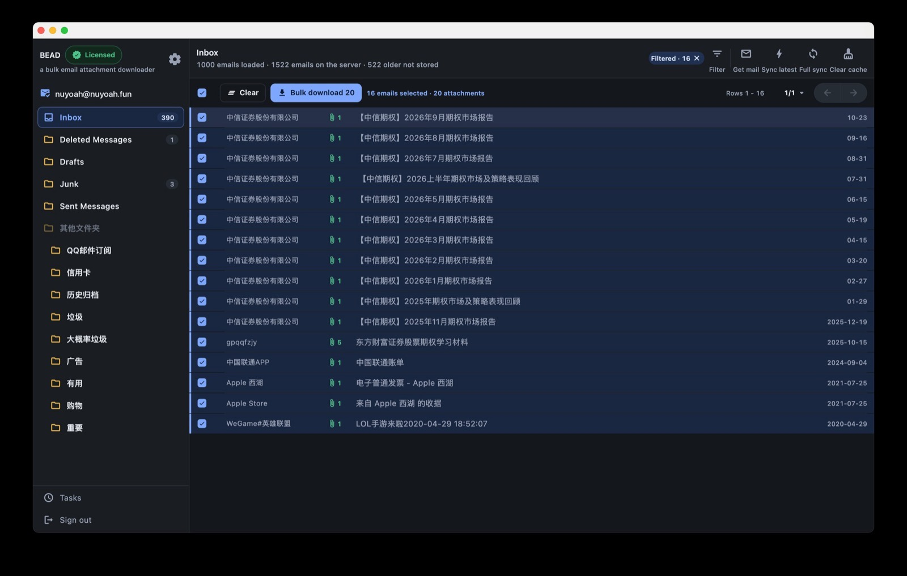
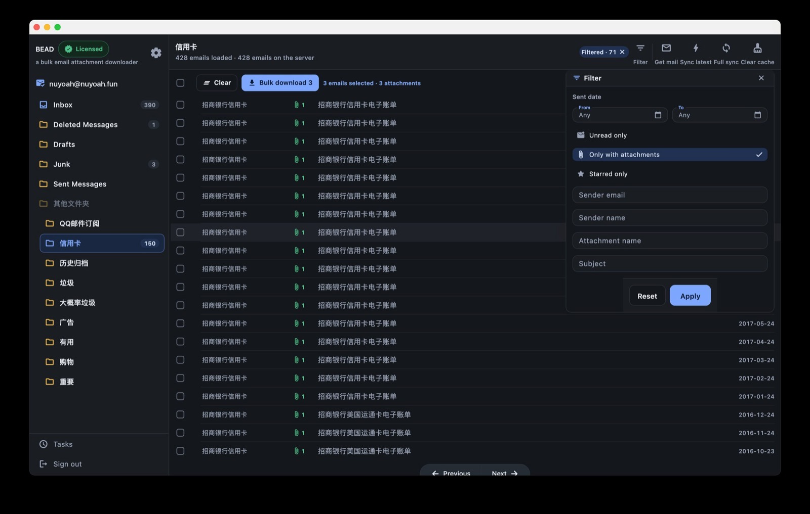
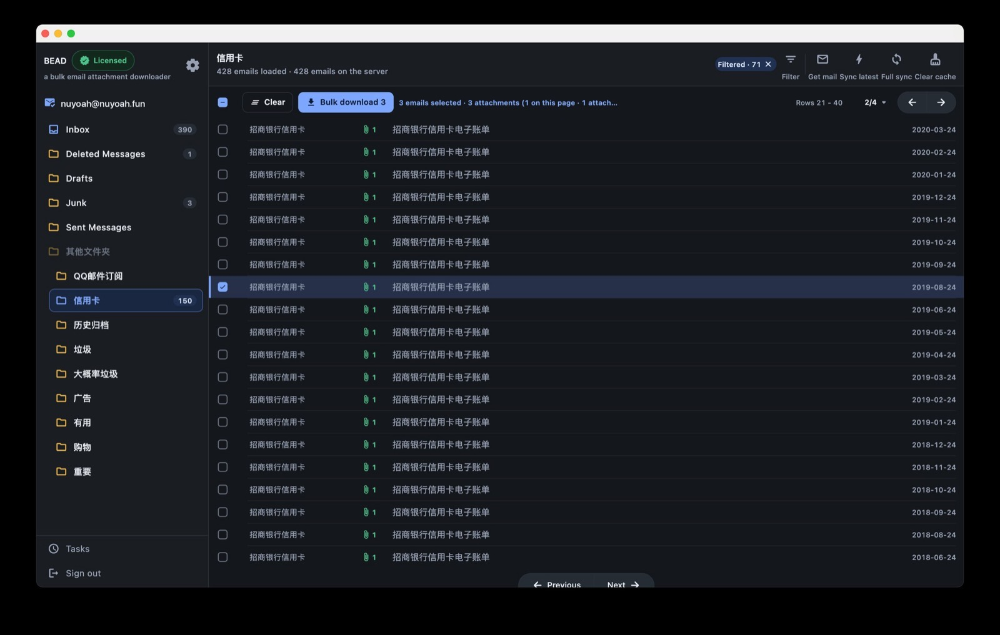
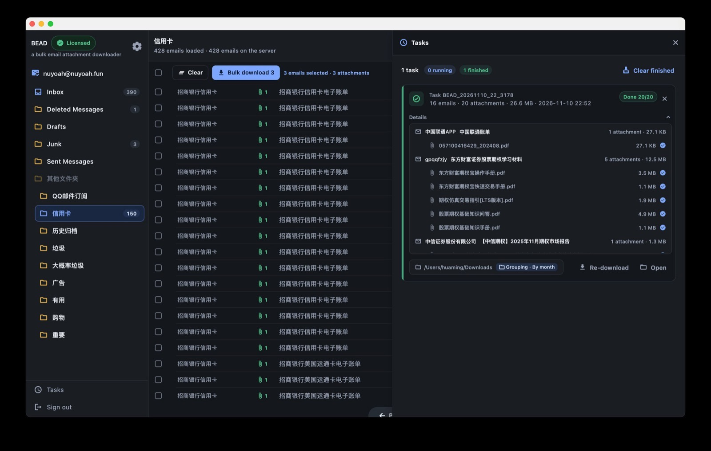

# BEAD

**B**ulk **E**mail **A**ttachment **D**ownloader — a desktop app for macOS and
Windows that connects to your mailbox over IMAP and downloads attachments from
many emails at once.

> **This repository hosts the release builds only.** There is no application
> source code here — the binaries in
> [Releases](https://github.com/nuyoah18/BatchEmailAttachmentDownloader/releases)
> are the whole content of this repo.

## Download

| Platform | Requirements | File |
| --- | --- | --- |
| macOS | macOS 12 or later | `BEAD-macos-universal.dmg` (Apple Silicon + Intel) |
| | | `BEAD-macos-arm64.dmg` / `BEAD-macos-x86_64.dmg` for a smaller single-arch build |
| Windows | Windows 10 / 11 · 64-bit | `BEAD-setup.exe` (installer) |
| | | `BEAD-windows-x64-live.zip` (portable, no install) |

Download from the
**[releases page](https://github.com/nuyoah18/BatchEmailAttachmentDownloader/releases)** —
each release lists its assets and version notes. Note that a release marked
**Pre-release** is not shown as GitHub's "Latest"; pick the highest stable tag,
or the pre-release if you deliberately want the newest build.

## What it does

- **Sign in with an IMAP account** — NetEase 163 / 126 / yeah.net / VIP 163 / 188,
  QQ Mail (including `@foxmail.com` aliases), NetEase and Tencent enterprise
  mailboxes (`imap.qiye.163.com`, `imap.exmail.qq.com`), iCloud, Gmail, Yahoo,
  AOL, or any custom IMAP server. Sign-in uses the client authorization code /
  app-specific password, not your web login password.
- **Browse every folder** — the full IMAP folder tree is listed recursively,
  with Inbox on top and unread counts shown per folder.
- **See attachments before downloading** — the mail list shows the subject,
  sender, read/answered/deleted state and every attachment's name and size,
  fetched from `BODYSTRUCTURE` alone. No message body is downloaded just to
  build the list.
- **Read the mail itself** — click a mail to open it in its own tab; the body
  is rendered as real HTML/CSS in the system WebView (WKWebView on macOS,
  WebView2 on Windows), with inline `cid:` images resolved locally and scripts
  disabled. Remote images load only when you ask for it.
- **Filter the list down to what you need** — a filter panel combines a sent-date
  range with *unread only*, *only with attachments*, *starred only*, and text
  matching on sender address, sender name, attachment file name and subject.
  Filters are applied to the cached index, so they are instant and can be
  cleared with one click on the **Filtered** chip.
- **Batch download in one action** — tick the mails you want and download them
  as **one task**. The toolbar always tells you what you are about to do
  (`16 emails selected · 20 attachments`), and selection is remembered across
  pages and folders, so you can gather mails from several pages — or several
  folders — before starting a single download. *Clear* drops the selection.
- **Choose the output layout** — flat
  (`<target dir>/<task id>/<file name>`, the default), grouped by sender
  (`<task id>/<sender>/<file name>`), or grouped by month
  (`<task id>/<yyyy-MM>/<file name>`). Duplicate file names get a suffix; the
  choice is remembered for next time and can be changed per task.
- **Task center** — a serial queue with per-attachment progress, live counters
  (`1 task · 0 running · 1 finished`) and a `Done 20/20` badge per task, plus
  cancel, retry, *continue* (resume the same task in place) and *re-download*
  (re-run the batch as a fresh task, keeping the original untouched). Each task
  card expands to list every mail and every attachment with its size and
  completion mark, alongside the totals (`16 emails · 20 attachments · 26.6 MB`)
  and the target folder. Finished tasks can be cleared in one go.
- **Safe writes** — each attachment is fetched completely and written to a
  `.part` file first, then renamed, so a file never exists half-written.
- **Works while you keep browsing** — downloads lease their own IMAP
  connection, so paging, opening another mail or switching folders does not
  block or wait for the queue.
- **Local caching built in** — mail headers, flags and unread counts are cached
  in a per-account SQLite database, so paging, sorting and filtering cost zero
  network requests. The header line reports exactly where you stand
  (`1000 emails loaded · 1522 emails on the server · 522 older not stored`).
  New mail never reshuffles the page you are reading; you decide when to pull
  it in — **Get mail** fetches only new mail, **Sync latest** refreshes the
  newest slice, **Full sync** re-reads the folder, and **Clear cache** drops the
  local index and rebuilds it.
- **Chinese / English UI** — follows the system language or a manual override
  in settings.

### Filtering

Date range, flags and text criteria stack together; the resulting list stays
pageable and sortable, and the active filter count is shown next to the chip
(`Filtered · 71`). *Reset* empties the form, *Apply* runs it.

### Selecting across pages

The selection counter splits the total from what the current page contributes
(`3 emails selected · 3 attachments (1 on this page · …)`), so you always know
whether a batch is complete before pressing **Bulk download**.

### Task center

Every task keeps its own record — mails, attachments, sizes, target folder and
grouping — and can be re-downloaded or opened in the file manager when finished.

## Install

### macOS

1. Open the `.dmg` and drag **BEAD** into `/Applications`. Use the universal
   build unless you specifically want the smaller arch-specific one.
2. The build is signed ad-hoc (not notarized by Apple), so the first launch is
   blocked by Gatekeeper. One of these gets past it:
   - Right-click the app in Finder → **Open** → confirm **Open**; or
   - `xattr -dr com.apple.quarantine /Applications/BEAD.app`

### Windows

1. Run `BEAD-setup.exe` and follow the installer, or extract
   `BEAD-windows-x64-live.zip` and run `BEAD.exe` from the extracted folder.
   Do not run it from inside a compressed archive viewer.
2. No separate runtime is needed — the VC++ runtime DLLs are bundled. Reading a
   mail body requires the **WebView2 runtime** — preinstalled on Windows 11 and
   on most Windows 10 machines with Edge; if it is missing, the reader pane
   offers a download link.

## Quick start

1. In your mailbox's web settings, enable IMAP and generate a **client
   authorization code / app-specific password**
   (NetEase: POP3/SMTP/IMAP settings; QQ Mail: Settings → Account; enterprise
   mailboxes: IMAP is usually enabled by the admin).
2. Launch the app, pick the mailbox **type** first, then enter your email
   address and the authorization code.
3. Choose a folder in the sidebar, tick the mails you need (optionally narrow
   the list with **Filter** first), and press **Bulk download**. Confirm the
   target folder and layout, and the task starts.
4. Follow progress in the **Task Center** panel, which opens from the sidebar.

## Licensing

Browsing, signing in and reading mail are always free. Downloads are
metered by license tier:

- **No license** — each download task can include the first **3** mails. It is
  not a total quota; the next task gets its own 3.
- **Licensed** — full batches, retries and re-downloads are unlocked.

Payment and activation happen inside the app through Dodo Payments. A license
key is bound to a limited number of devices; activation state is stored in the
system Application Support folder and validated against the license service.

## Privacy and local data

- **Credentials never touch the disk.** The authorization code is kept in
  memory only and is cleared on sign-out.
- Account settings, list preferences, the local mail cache and the license file
  live under the app's Application Support directory
  (`~/Library/Containers/com.nuyoah.bead/Data/Library/Application Support/com.nuyoah.bead/`
  on macOS). Deleting them resets the app to a fresh state. Data written by
  earlier builds under a `com.mailtool.*` bundle identifier is not read by BEAD.
- The app talks to your IMAP server and to the license service only — no
  analytics or telemetry.

## Known limitations

- Attachments are read into memory before being written to disk; very large
  single attachments (hundreds of MB) need comparable free RAM.
- Downloads within a task run one attachment at a time.
- Only the newest mails of a folder are cached by default — older ones are
  fetched on demand, or after **Full sync**.

## Issues and feedback

Bug reports and feature requests are welcome in
[Issues](https://github.com/nuyoah18/BatchEmailAttachmentDownloader/issues).
Please include your platform, the version from the About window, and the steps
to reproduce.

## Versioning

Each release is tagged `v1`, `v2`, … and the tag's assets are the builds for
that version. See the
[releases page](https://github.com/nuyoah18/BatchEmailAttachmentDownloader/releases)
for what changed in each build.
