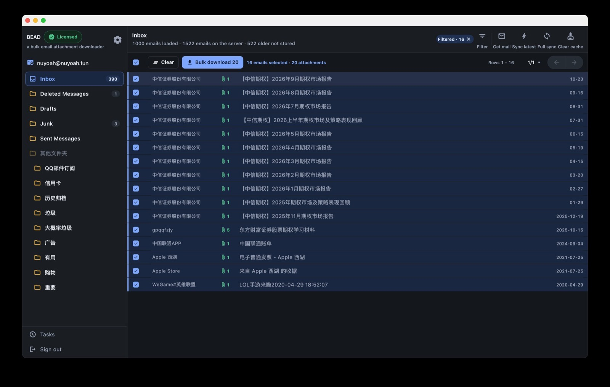
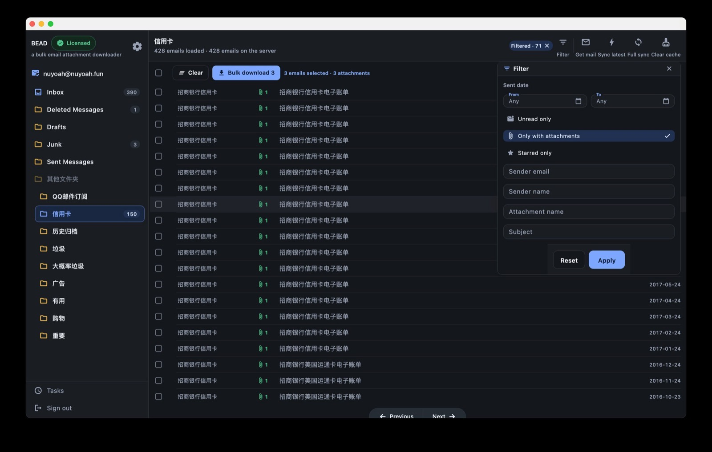
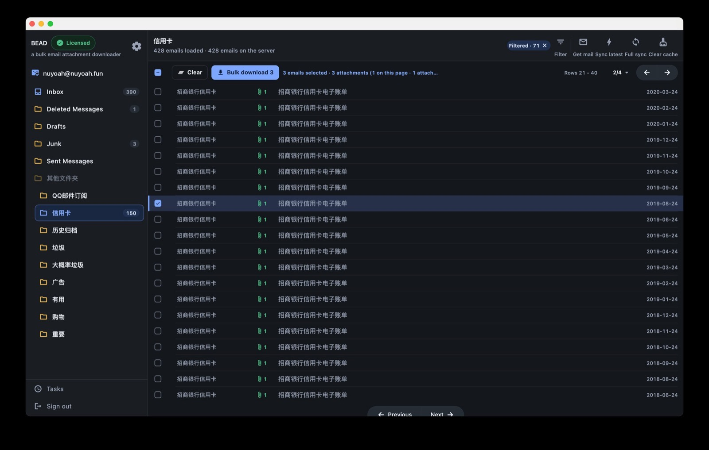
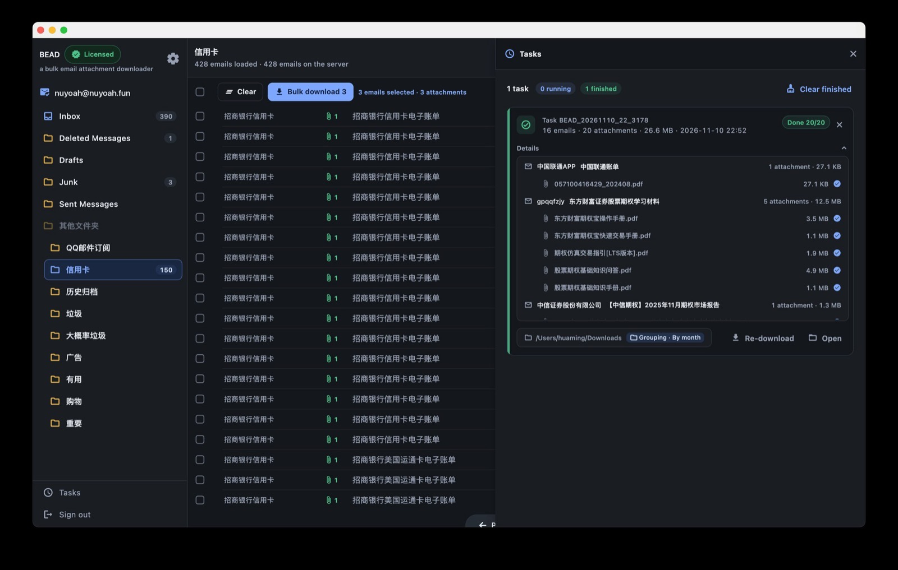

# BEAD

**BEAD** — IMAP 邮件附件批量下载器。别再一封封下载附件：先筛选，跨页勾选，
一次入队，整批下完。

[English](README.md) | 简体中文

> **本仓库只存放发行版安装包**，不含应用源代码 ——
> [Releases](https://github.com/nuyoah18/BEAD/releases) 中的二进制文件就是本仓库的全部内容。

## 下载

| 平台 | 系统要求 | 文件 |
| --- | --- | --- |
| macOS | macOS 12 或更高 | `BEAD-macos-universal.dmg`（Apple Silicon + Intel 通用） |
| | | `BEAD-macos-arm64.dmg` / `BEAD-macos-x86_64.dmg`（单架构，体积更小） |
| Windows | Windows 10 / 11 · 64 位 | `BEAD-setup.exe`（安装版） |
| | | `BEAD-windows-x64-live.zip`（免安装便携版） |

请到 **[Releases 页面](https://github.com/nuyoah18/BEAD/releases)** 下载 ——
每个版本都列出了安装包和更新说明。标记为 **Pre-release** 的版本不会显示为
GitHub 的 "Latest"；除非你明确想要最新构建，请选最高的稳定版本号。

## 工作原理

BEAD 使用标准 IMAP 协议，**直连你的邮件服务器** —— 中间没有我们的任何服务
器或代理。不需要脚本，不需要浏览器扩展。登录用的是邮箱为第三方应用签发的
**客户端授权码 / 应用专用密码**，而不是你的网页登录密码。

已实测支持 Gmail、iCloud、Outlook、Yahoo、AOL、QQ 邮箱（含 `@foxmail.com`
别名）、网易 163 / 126 / yeah.net、网易和腾讯企业邮箱
（`imap.qiye.163.com`、`imap.exmail.qq.com`）、Zoho、Yandex，以及任意自定义
IMAP 服务器。

## 功能

- **筛出要的那一批** —— 筛选面板把发送日期范围与「仅未读」「仅含附件」「仅
  星标」，以及发件人地址、发件人名称、主题、附件文件名的文本匹配组合起来，
  所有条件同时生效。筛选在本地缓存上执行，即时出结果，激活的筛选数量直接
  显示在 **已筛选** 标签上。
- **跨页累积，一次入队** —— 这页勾 3 封，下一页勾 20 封，选择按文件夹保留；
  多个文件夹的邮件也能并进同一个任务。工具栏始终告诉你下一步会发生什么
  （`已选 16 封邮件 · 20 个附件`）。
- **存下来的东西是整齐的** —— 平铺、按发件人、按月份、按邮件四种归档模式
  按任务选择；重名文件自动加后缀，还可以把邮件日期写进文件名。
- **一个失败，不拖整批** —— 失败按附件逐条记录，其余附件继续下载；最后只
  重试失败的那些。
- **关掉应用，回来接着下** —— 任务和每个附件的进度都存在本机；退出或重启
  电脑后，点 **继续** 接着下。
- **安全的写入** —— 附件先写入临时文件，下载完成后才改名落盘，不会出现
  写了一半的文件。
- **下载前先看清附件** —— 邮件列表的主题、发件人、已读/已回复状态和每个
  附件的名称、大小全部来自 `BODYSTRUCTURE`，不为列表去拉正文。点开邮件即可
  阅读正文：在系统 WebView 中渲染真实 HTML/CSS，禁用脚本，远程图片默认不
  加载、经你确认后才显示。
- **下载时照常浏览** —— 下载租用自己的 IMAP 连接，翻页、读信、切换文件夹
  都不用等队列。
- **同步由你决定** —— **收取新邮件**只拉增量，**同步最近**刷新最新 N 封，
  **全量同步**回填更早的邮件，**清空缓存**重建本地索引。列表头部会明确报告
  当前状态（`已载入 1000 封 · 服务器共 1522 封 · 522 封较早邮件未载入`）。
- **本地缓存内建** —— 邮件头、标志和未读数缓存在每账号的 SQLite 数据库里，
  翻页、重排、改每页数量都不产生网络请求。
- **只读，且只在你这台电脑** —— 阅读永远不会把邮件标成已读，不会删除，也
  不会加标志。
- **界面支持 11 种语言** —— 跟随系统语言，也可以在设置里手动指定。

### 筛选

日期范围、标志和文本条件叠加生效；筛选后的列表照常翻页、排序。*重置*
清空表单，*应用* 执行筛选。

### 跨页选择

选择计数会把总数和当前页贡献的部分分开显示（`已选 3 封 · 3 个附件（本页
1 封 · …）`），按下 **批量下载** 之前，你始终知道这批是不是选全了。

### 任务中心

每个任务都保留自己的记录 —— 邮件、附件、大小、目标文件夹和归档模式 ——
完成后可以重新下载，也可以直接在文件管理器里打开。

## 谁在用

- **财务 / 审计** —— 供应商多年的发票和对账单，按发件人整归档，邮件日期写
  进文件名。
- **设计 / 工程** —— 只能靠附件传的设计源文件、CAD 图纸和压缩包，一个任务
  一次拉完。
- **法务 / 行政** —— 合同和正式文件按月份归档。
- **运营 / 支持** —— 报表和媒体文件原名保存：RFC 2047、RFC 2231 续名和
  GBK 原始字节文件名自动解码，不再乱码。

## 一次买断，永久使用

浏览、搜索、筛选和阅读邮件**永久免费**，只有批量下载按授权计：

- **无授权** —— 每个下载任务可以包含前 **3** 封邮件。不是总量配额；下一个
  任务另有 3 封。
- **已授权** —— 解锁完整批次、重试和重新下载。

**$19 买断** —— 一台电脑（Mac 或 Windows）终身使用，无订阅。账号、文件夹
和下载任务数量不限；四种归档模式全开；界面语言全开。

购买和激活都在应用内通过 Dodo Payments 完成。一个授权码激活有限数量的设备
—— 换电脑时可以先解绑旧设备再激活新设备。团队采购可一次买多份（例如
2 份 · $38）。

## 安装

### macOS

1. 打开 `.dmg`，把 **BEAD** 拖进 `/Applications`。除非明确想要更小的单架构
   包，否则请用 universal 通用版。
2. 安装包为 ad-hoc 签名（未经 Apple 公证），首次启动会被 Gatekeeper 拦截，
   任选其一放行：
   - 在访达中右键点击应用 → **打开** → 确认 **打开**；或
   - `xattr -dr com.apple.quarantine /Applications/BEAD.app`

### Windows

1. 运行 `BEAD-setup.exe` 按安装向导操作；或解压
   `BEAD-windows-x64-live.zip`，在解压目录里运行 `BEAD.exe`。不要在压缩软件
   的预览窗口里直接运行。
2. 无需额外运行库 —— VC++ 运行时 DLL 已内置。阅读邮件正文需要 **WebView2
   运行时** —— Windows 11 和大多数装了 Edge 的 Windows 10 已预装；若缺失，
   阅读面板会提供下载链接。

## 快速上手

1. 在邮箱的网页版设置里开启 IMAP，并生成**客户端授权码 / 应用专用密码**
   （网易：POP3/SMTP/IMAP 设置；QQ 邮箱：设置 → 账户；Gmail、Yahoo 等：
   应用专用密码；企业邮箱：IMAP 通常由管理员开启）。
2. 启动应用，先选邮箱**类型**，再输入邮箱地址和授权码。
3. 在侧边栏选一个文件夹，勾选需要的邮件（可以先用 **筛选** 缩小范围），按
   **批量下载**，确认目标文件夹和归档模式后任务开始。
4. 在 **任务中心**（从侧边栏打开）查看进度。

## 常见问题

**怎么批量下载附件？**
连接邮箱，筛选或搜索列表，跨任意多页勾选邮件，按 **批量下载**。选择会跨页
、跨文件夹累积，直到你入队。

**一批有没有数量上限？**
没有上限。数万封邮件作为一个任务是正常用法。任务内附件逐个串行下载，避免
压垮邮件服务器，界面保持流畅。

**下载会改动我的邮箱吗？**
不会。BEAD 是只读的 —— 从不在服务器上标记已读、删除邮件或添加标志。

**授权码是什么？**
邮箱专门为第三方应用签发的密码，你的网页登录密码不会交给桌面客户端。

**某个附件下载失败怎么办？**
其余附件继续下载；失败按附件逐条记录，之后只重试失败的。文件先写临时文件
、完成才改名，不会得到截断的文件。

**乱码附件名能修吗？**
能 —— RFC 2047、RFC 2231 续名和 GBK 原始字节文件名自动解码。

## 隐私与本地数据

- 应用只连接你的 IMAP 服务器和授权服务 —— 无统计埋点，无遥测。
- **授权码不落盘。** 只保存在内存中，退出登录即清除。
- 账号设置、列表偏好、本地邮件缓存和授权文件存放在应用的应用支持目录
  （macOS 上为
  `~/Library/Containers/com.nuyoah.bead/Data/Library/Application Support/com.nuyoah.bead/`）。
  删除这些文件即可把应用重置为初始状态。

## 已知限制

- 附件在写入磁盘前先整体读入内存；几百 MB 的超大单个附件需要相近的空闲内存。
- 同一任务内的下载逐个串行进行。
- 每个文件夹默认只缓存最新邮件 —— 更早的邮件按需拉取，或执行 **全量同步**
  后载入。

## 反馈与链接

- 官网：[nuyoah.fun](https://nuyoah.fun)
- 发行版：[github.com/nuyoah18/BEAD/releases](https://github.com/nuyoah18/BEAD/releases)
- 问题反馈：[github.com/nuyoah18/BEAD/issues](https://github.com/nuyoah18/BEAD/issues) ——
  请附上系统平台、「关于」窗口里的版本号和复现步骤。
- Gitee 镜像：[gitee.com/nuyoah18/bead](https://gitee.com/nuyoah18/bead)
- 邮箱：nuyoah@nuyoah.fun

每个版本都以标签发布（`v1.0.5`、…），标签下的资产就是该版本的安装包；每个
构建的变更内容见 Releases 页面。
